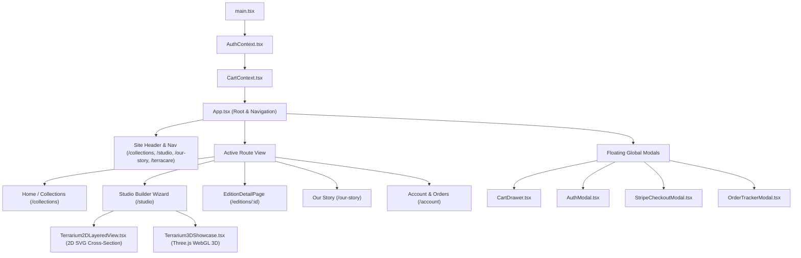

# 🌿 TerraScape — Architecture & Developer Guide

Welcome to the **TerraScape** codebase! This document outlines the application architecture, directory structure, data flows, and technical subsystems of the **Guided Studio Wizard & Curated E-Commerce Platform**.

---

## 1. High-Level Overview

**TerraScape** is a digital e-commerce and interactive specification platform for custom living botanical terrariums equipped with custom-engineered microclimate hardware:
- **PWM Circadian LED Lighting:** Microcontroller-driven spectrum control mimicking natural sun & twilight cycles.
- **Ultrasonic Piezo Misting:** High-frequency atomizing transducers producing ultra-fine micro-mist (1–5µm droplet diameter).
- **Active Aeration:** Micro-ventilation fans providing continuous air exchange to prevent mold.

The application guides customers through a curated 4-step wizard (**01 Vessel & Lid** $\rightarrow$ **02 Foundation** $\rightarrow$ **03 Flora** $\rightarrow$ **04 Details**), pairs it with a dual **2D procedural cross-section stage** and an interactive **Three.js WebGL 3D showcase**, and manages cart, authentication, and living assembly order tracking.

---

## 2. Directory & File Structure

```text
src/
├── main.tsx                           # React DOM entry point (wraps AuthProvider & CartProvider)
├── App.tsx                            # Root application orchestrator, router & Studio Builder wizard
├── index.css                          # Global design tokens, official TerraScape branding palette
├── Terrarium2DLayeredView.tsx         # Procedural 2D cross-section SVG stage with custom soil slices
├── Terrarium3DShowcase.tsx            # Three.js WebGL 3D showcase with OrbitControls & mist particles
├── types/
│   ├── auth.ts                        # User credentials, session profiles & auth state types
│   └── terrarium.ts                   # Core domain types (Vessel, Substrate, Hardware, Order)
├── data/
│   ├── index.ts                       # Barrel export for master catalogs
│   ├── vessels.tsx                    # Hand-blown glass vessels & smart lid specs
│   ├── substrates.ts                  # 6 geological soil & drainage layers
│   ├── catalogItems.tsx               # Curated botanical & hardscape vector catalog
│   ├── hardware.ts                    # 4 custom PCB / misting circuit modules
│   └── presets.ts                     # Curated ecosystem presets (Rainforest, Cloud Forest, etc.)
├── utils/
│   ├── router.ts                      # Clean client-side pathname router (/collections, /studio, etc.)
│   ├── stripeCheckoutEngine.ts        # Authoritative pricing validator & 5-stage order simulator
│   └── soundEffects.ts                # Zero-asset Web Audio API procedural synthesizer
├── context/
│   ├── AuthContext.tsx                # User session management with localStorage persistence
│   └── CartContext.tsx                # Global shopping cart, order storage & tracker state
└── components/
    ├── CartDrawer.tsx                 # Slide-over cart drawer with itemized line items
    ├── AuthModal.tsx                  # Sign up / sign in modal (warm botanical parchment theme)
    ├── StripeCheckoutModal.tsx        # In-app Stripe PaymentElement & address collection modal
    ├── OrderTrackerModal.tsx          # 5-stage living vivarium assembly & quarantine tracker
    └── EditionDetailPage.tsx         # Detailed showcase page for Andrew's Signature Editions
```

---

## 3. Component Hierarchy & Data Flow



---

## 4. Key Technical Subsystems

### A. Guided Studio Wizard (`src/App.tsx`)
- Structured step-by-step customizer divided into 4 sequential categories:
  1. **Vessel:** Single-choice glass enclosure with integrated smart climate lid.
  2. **Foundation:** Soil recipes (Pacific Forest, Volcanic Backwall, Cloud Tropical) with an expandable drawer to adjust layer depths and wave contours.
  3. **Flora:** Multi-select botanical specimens with an internal toggle for single-unit selection (no duplicates, default) vs. multi-quantity ($0\text{--}5$).
  4. **Details:** Sculptural hardscape accents (Mopani wood, river stones, volcanic accent stones).
- State persists in browser `sessionStorage` so navigating to other pages or refreshing never loses user configuration.

### B. Procedural 2D Layered View (`src/Terrarium2DLayeredView.tsx`)
- Renders an illustrated architectural cross-section of the apothecary jar.
- Stacks substrate layers upward from `y = 496`, dynamically computing slice heights from each layer's `depthMm` specification.
- Dynamically renders active plant fronds, moss bases, and volcanic rock accents based on active selections.

### C. Interactive 3D Showcase (`src/Terrarium3DShowcase.tsx`)
- Dynamically loads Three.js, `GLTFLoader`, and `OrbitControls` on demand.
- Renders `public/models/terrarium-hero.glb` with ACES Filmic tone mapping, ambient illumination, and interactive particle mist simulation.
- Gracefully falls back to high-resolution photography if WebGL is unavailable on the client device.

### D. Authoritative Pricing & Tamper Protection (`src/utils/stripeCheckoutEngine.ts`)
- Client-side DOM manipulation cannot spoof prices: `validateCartPricing()` recalculates subtotals against immutable master catalog constants (`VESSELS`, `SUBSTRATES`, `CATALOG_ITEMS`, `HARDWARE_MODULES`).
- Flags tampering if the submitted price deviates by more than $\$0.01$.

### E. 5-Stage Living Assembly & Quarantine Tracker (`src/components/OrderTrackerModal.tsx`)
- Replaces generic carrier status with the real-world botanical and hardware fabrication pipeline:
  1. `BLUEPRINT_RECEIVED`
  2. `CIRCUIT_SOLDERING`
  3. `PLANTING`
  4. `QUARANTINE` (7-day humidity stabilization & springtail balance)
  5. `SHIPPED` (Climate-controlled courier / thermal crate)

### F. Zero-Asset Procedural Web Audio (`src/utils/soundEffects.ts`)
- Synthesizes organic sound design on the fly via the native `AudioContext`:
  - `playPop()`: Sine wave frequency sweep ($280\text{--}580\text{ Hz}$).
  - `playSand()`: Bandpass-filtered white noise burst ($1100\text{ Hz}$).
  - `playMist()`: Highpass-filtered white noise envelope ($2800\text{ Hz}$).
- Exactly **0 KB** of external audio files transferred over the network.

---

## 5. Design System & Palette

The entire interface adheres to the warm, organic **TerraScape Brand Palette**:
- **Forest:** `#18392b` (Deep primary botanical green)
- **Cream:** `#f8f5ee` (Light background surface)
- **Parchment:** `#f0ede3` (Card and secondary panel fill)
- **Moss:** `#657a4e` (Mid-tone natural accent)
- **Lichen:** `#b8c2a1` (Soft badge and highlight tone)
- **Clay:** `#b96d4b` (Terracotta warm accent)
- **Muted Ink:** `#546358` (Body copy and secondary labels)
- **Border:** `rgba(24, 57, 43, 0.14)` (Subtle organic divider)
