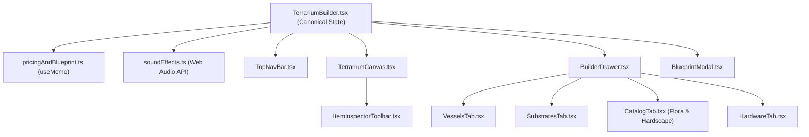

# 🌿 TerraScape — Architecture & Developer Onboarding Guide

Welcome to the **TerraScape** codebase! This document explains how the application is structured, how data and state flow between modules, and how to extend the studio with new vessels, botanicals, substrates, or smart hardware modules.

---

## 1. High-Level Overview

TerraScape is an interactive 2D SVG product configurator and e-commerce specification builder for custom-built botanical terrariums equipped with micro-climate electronics (PWM circadian LED rings, ultrasonic piezo misting manifolds, and closed-loop I2C humidity controllers).

Instead of a monolithic file, the codebase is organized by responsibility:
- **Domain Types (`src/types/`)** — Shared TypeScript contracts.
- **Static Catalogs & SVG Assets (`src/data/`)** — Declarative definitions of vessels, soil layers, flora/hardscape SVG artwork, smart hardware SKUs, and curated presets.
- **Pure Utilities (`src/utils/`)** — Procedural Web Audio sound synthesis (`soundEffects.ts`) and Bill-of-Materials (BOM) pricing + JSON blueprint serialization (`pricingAndBlueprint.ts`).
- **UI Components (`src/components/`)** — Modular React components separated into the top bar, interactive SVG stage, floating item inspector, responsive drawer tabs, and checkout blueprint modal.
- **State Orchestrator (`src/TerrariumBuilder.tsx`)** — Holds the canonical build state and wires events between the drawer, top bar, canvas, and checkout modal.

---

## 2. Directory & File Structure

```text
src/
├── main.tsx                           # React DOM entry point
├── App.tsx                            # Root wrapper rendering <TerrariumBuilder />
├── TerrariumBuilder.tsx               # Main state orchestrator (~260 lines)
├── types/
│   └── terrarium.ts                   # All domain TypeScript types & interfaces
├── data/
│   ├── index.ts                       # Barrel export for all catalogs
│   ├── vessels.tsx                    # 6 glass vessels (clipPath, outlinePath, lids/bases)
│   ├── substrates.ts                  # 6 soil & drainage layer definitions
│   ├── catalogItems.tsx               # 16+ flora & hardscape items with inline SVG renderers
│   ├── hardware.ts                    # 4 custom PCB / misting hardware modules
│   └── presets.ts                     # Curated ecosystems (Rainforest, Desert, Hollow)
├── utils/
│   ├── soundEffects.ts                # Zero-asset Web Audio API synthesizer (pop, sand, mist)
│   └── pricingAndBlueprint.ts         # Pure BOM calculator & Blueprint JSON serializer
└── components/
    ├── TopNavBar.tsx                  # Header bar: presets, lighting mode, mist button, CTA
    ├── TerrariumCanvas.tsx            # Interactive 2D SVG stage, pointer dragging, BOM pill
    ├── ItemInspectorToolbar.tsx       # Floating toolbar for scaling/rotating/layering items
    ├── BuilderDrawer.tsx              # Responsive sidebar / mobile bottom sheet container
    ├── BlueprintModal.tsx             # BOM quote & JSON blueprint export modal
    └── tabs/
        ├── VesselsTab.tsx             # Tab 1: Glass enclosure selector
        ├── SubstratesTab.tsx          # Tab 2: Soil layer adder, reorder & depth/wave sliders
        ├── CatalogTab.tsx             # Tab 3 & 4: Flora & Hardscape grid picker
        └── HardwareTab.tsx            # Tab 5: Smart vivarium circuit module toggles
```

---

## 3. Component Hierarchy & Data Flow



### State Ownership (`src/TerrariumBuilder.tsx`)
All core configuration state lives in `TerrariumBuilder.tsx` so that any change immediately updates the SVG canvas, the live BOM price badge in the navbar, and the serialized JSON blueprint:
1. **`vesselId` (`VesselId`)**: Currently active glass vessel (`globe`, `wardian`, `apothecary`, `cloche`, `teardrop`, `flask`).
2. **`substrates` (`SubstrateLayer[]`)**: Ordered array (bottom-to-top, up to 6 layers) with `depth` (15–85mm) and `contour` (-25 to +25 wave slope).
3. **`items` (`PlacedItem[]`)**: Botanical and hardscape specimens placed on the stage, storing `{ x, y, scale, rotation, flipX, zIndex }`.
4. **`equippedHardware` (`HardwareId[]`)**: Active smart hardware SKUs integrated into the build.
5. **`selectedUid` (`string | null`)**: Currently selected specimen on the canvas (controls visibility of `ItemInspectorToolbar` and keyboard shortcuts `Delete`/`Backspace`/`Escape`).
6. **`lighting` (`LightingMode`)**: `'day' | 'golden' | 'night'`. Passed down to `TerrariumCanvas` and `CatalogTab` so bioluminescent items (`mycena`, `amethyst`, `lantern`) glow in night mode.

---

## 4. Key Technical Subsystems

### A. SVG Coordinate System & Pointer Dragging (`src/components/TerrariumCanvas.tsx`)
- The SVG canvas uses a fixed internal coordinate space of `viewBox="0 0 400 500"`.
- Because the SVG scales responsively across mobile and desktop screens, raw mouse/touch `clientX`/`clientY` pixel coordinates cannot be used directly.
- **`getSvgCoords(clientX, clientY)`** uses `svg.createSVGPoint()` and `svg.getScreenCTM().inverse()` to accurately project screen pointer events into the `400x500` SVG coordinate space regardless of screen size or aspect ratio padding.
- Everything inside the glass (LED light cone, fairy lights, soil layers, plants, and mist particles) is wrapped in `<g clipPath="url(#vesselClip)">` so items and substrate layers are cleanly masked to the contour of the chosen glass vessel.

### B. Dynamic Wave-Contoured Substrate Stacking (`src/components/TerrariumCanvas.tsx`)
- Substrate layers stack upward starting from the vessel base (`y = 440`).
- Each layer computes a closed SVG quadratic Bezier path (`Q 200 controlY 370 y`) using its `depth` and `contour` properties, seamlessly mating the top curve of layer $n$ with the bottom curve of layer $n+1$.
- When a user plants a new specimen, `getTopSubstrateY()` in `TerrariumBuilder.tsx` sums the active substrate depths so the new plant lands naturally on top of the soil surface.

### C. Live BOM Engine & Blueprint Serialization (`src/utils/pricingAndBlueprint.ts`)
- **`calculateBomSummary()`** calculates itemized subtotals for the vessel, substrate stack, placed specimens, smart hardware modules, and fulfillment fee (`+$25` for local studio assembly vs. `$0` for nationwide DIY kit).
- **`serializeBlueprint()`** outputs a deterministic `SerializedBlueprint` JSON object with exact SKUs, layer depths/slopes, and `(x, y, scale, rotation, flipX, zIndex)` specimen coordinates. In Phase 3, this payload will be sent directly to the backend for server-side price validation and Stripe Checkout metadata.

### D. Procedural Web Audio Synthesizer (`src/utils/soundEffects.ts`)
- `SoundEffects` uses the browser's native `AudioContext` to synthesize organic UI feedback on the fly with zero external MP3/WAV files:
  - `sfx.playPop(pitchMultiplier)` — Sine wave frequency sweep for planting, selecting, or toggling hardware.
  - `sfx.playSand()` — Bandpass-filtered white noise burst when adding, reordering, or removing soil layers.
  - `sfx.playMist()` — Highpass-filtered white noise envelope when testing the ultrasonic mister.

---

## 5. Common Onboarding Tasks (How to Extend)

### How to Add a New Plant or Hardscape Specimen
1. Open `src/data/catalogItems.tsx`.
2. Append a new `CatalogItem` object to `CATALOG_ITEMS`:
   - Give it a unique `id` and `sku` (e.g., `'FLR-ORC'` or `'HRD-QRT'`).
   - Set `category: 'flora'` or `'hardscape'`.
   - Set `bioluminescent: true` if it should react to Night Mode (`isNight` parameter in `renderSvg`).
   - Draw the SVG artwork inside `renderSvg: (isNight) => (<g>...</g>)` anchored around `(0, 0)` as the base/roots of the item (growing upward into negative `y` values).

### How to Add a New Glass Vessel
1. Open `src/types/terrarium.ts` and add the new ID literal to `VesselId`.
2. Open `src/data/vessels.tsx` and add the new `VesselConfig` entry with its `clipPath`, `outlinePath`, `highlightPath`, and optional `lidElement` / `baseElement` within the `400x500` viewBox (with the vessel floor around `y = 440`).

### How to Add a New Smart Hardware Module
1. Open `src/types/terrarium.ts` and add the new ID literal to `HardwareId`.
2. Open `src/data/hardware.ts` and add the module's SKU, specs, power draw, and price to `HARDWARE_MODULES`.
3. (Optional) If the hardware has a visual effect inside the glass vessel, render it conditionally inside `src/components/TerrariumCanvas.tsx` using `equippedHardware.includes('your_new_id')`.
