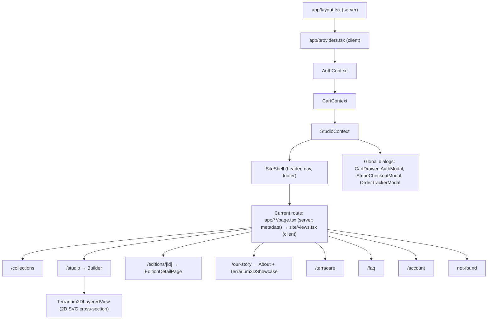

# 🌿 TerraScape — Architecture & Developer Guide

Welcome to the **TerraScape** codebase! This document outlines the application architecture, directory structure, data flows, and technical subsystems of the **Guided Studio Wizard & Curated E-Commerce Platform**.

---

## 1. High-Level Overview

**TerraScape** is a digital e-commerce and interactive specification platform for custom living botanical terrariums equipped with custom-engineered microclimate hardware:
- **PWM Circadian LED Lighting:** Microcontroller-driven spectrum control mimicking natural sun & twilight cycles.
- **Ultrasonic Piezo Misting:** High-frequency atomizing transducers producing ultra-fine micro-mist (1–5µm droplet diameter).
- **Active Aeration:** Micro-ventilation fans providing continuous air exchange to prevent mold.

The application guides customers through a curated 4-step wizard (**01 Vessel & Lid** $\rightarrow$ **02 Foundation** $\rightarrow$ **03 Flora** $\rightarrow$ **04 Details**), pairs it with a dual **2D procedural cross-section stage** and an interactive **Three.js WebGL 3D showcase**, and manages cart, authentication, and living assembly order tracking.

---

## 2. Directory & File Structure

The site runs on **Next.js 16 (App Router)**. Every URL is a folder under `src/app/`; the page code lives in `src/site/views.tsx` and the shared state in providers.

```text
next.config.ts                         # Redirects for old/alternative URLs (/home, /about, /build, /edition/:id, hyphenated editions)
vercel.json                            # Tells Vercel this is a Next.js project and to build with `npm run vercel-build` (migrate + seed + build)
src/
├── app/                               # App Router: one folder per URL
│   ├── layout.tsx                     # <html>/<body>, site-wide metadata (title template, description, Open Graph, icons), fonts
│   ├── providers.tsx                  # Client providers (auth, cart, Studio) + site header/footer + global dialogs
│   ├── not-found.tsx                  # 404 page (real 404 status, noindex)
│   ├── api/auth/[...all]/route.ts     # Better Auth endpoints (sign-up, sign-in, sign-out, session, Google callback)
│   ├── collections/ studio/ our-story/ terracare/ faq/ account/
│   │   └── page.tsx                   # Exports the page's metadata and renders its view
│   └── editions/[id]/page.tsx         # The three studio editions, prerendered; per-edition title and share image
├── site/
│   ├── views.tsx                      # Page components (Collection, Studio builder, Our Story, TerraCare, FAQ, Account, not-found) and the route views
│   ├── SiteShell.tsx                  # Header (nav, account/jar actions, mobile menu) and footer
│   ├── StudioContext.tsx              # The Studio design in progress (selections, soil layers, step), kept in sessionStorage
│   └── navigation.ts                  # useAppNavigate(): page names and aliases → canonical URLs via the Next.js router
├── server/                            # Server-only code (never sent to the browser)
│   ├── auth.ts                        # Better Auth config: email + password, Google, roles, rate limits
│   ├── authFlags.ts                   # googleSignInEnabled (read by the layout)
│   ├── db.ts                          # Prisma client, created on first query
│   └── prismaAdapter.ts               # Neon driver for Neon, standard Postgres driver elsewhere (CI)
├── lib/
│   └── authClient.ts                  # Better Auth browser client
├── index.css                          # Global design tokens, official TerraScape branding palette
├── Terrarium2DLayeredView.tsx         # Procedural 2D cross-section SVG stage with custom soil slices
├── Terrarium3DShowcase.tsx            # Three.js WebGL 3D showcase with OrbitControls & mist particles (three is bundled from npm)
├── types/
│   ├── auth.ts                        # User credentials, session profiles & auth state types
│   └── terrarium.ts                   # Blueprint, cart and order types (prices in integer cents)
├── catalog/
│   ├── index.ts                       # Single product catalog: Studio options, soil recipes, editions, accessories, fees
│   ├── editions.ts                    # Studio edition content, Studio presets and site photography (plain data, usable on the server)
│   ├── delivery.ts                    # Delivery options, fees, lead times and quarantine length
│   ├── money.ts                       # formatCents() / formatCentsExact() display helpers
│   └── studioBlueprint.ts             # Turns Studio selections into a SerializedBlueprint
├── hooks/
│   └── useDialogFocus.ts              # Focus, Tab and Escape handling for the dialogs
├── utils/
│   ├── router.ts                      # Page names and URL aliases → canonical paths (used by useAppNavigate)
│   ├── stripeCheckoutEngine.ts        # Authoritative pricing validator & 5-stage order simulator
│   └── soundEffects.ts                # Zero-asset Web Audio API procedural synthesizer
├── context/
│   ├── AuthContext.tsx                # useAuth(): session from Better Auth, sign-in/up/out, the sign-in dialog
│   └── CartContext.tsx                # Global shopping cart, order storage & tracker state (restored after mount)
├── components/
│   ├── CartDrawer.tsx                 # Slide-over cart drawer with itemized line items
│   ├── AuthModal.tsx                  # Sign up / sign in modal (warm botanical parchment theme)
│   ├── StripeCheckoutModal.tsx        # In-app Stripe PaymentElement & address collection modal
│   ├── DeliveryOptionPicker.tsx       # Shared order-level delivery choice (cart drawer + checkout)
│   ├── OrderTrackerModal.tsx          # 5-stage living vivarium assembly & quarantine tracker
│   └── EditionDetailPage.tsx         # Detailed showcase page for Andrew's Signature Editions
└── test/                              # Vitest setup, Next.js router stand-ins and the TestSite harness
```

---

## 3. Component Hierarchy & Data Flow



Browser-only state (cart, orders, Studio design) starts empty on the server and is restored from storage right after the page loads, so the server-rendered HTML and the first client render match.

---

## 4. Key Technical Subsystems

### A. Guided Studio Wizard (`src/site/views.tsx` + `src/site/StudioContext.tsx`)
- Structured step-by-step customizer divided into 4 sequential categories:
  1. **Vessel:** Single-choice glass enclosure with integrated smart climate lid.
  2. **Foundation:** Soil recipes (Pacific Forest, Volcanic Backwall, Cloud Tropical) with an expandable drawer to adjust layer depths and wave contours.
  3. **Flora:** Multi-select botanical specimens with an internal toggle for single-unit selection (no duplicates, default) vs. multi-quantity ($0\text{--}5$).
  4. **Details:** Sculptural hardscape accents (Mopani wood, river stones, volcanic accent stones).
- State persists in browser `sessionStorage` so navigating to other pages or refreshing never loses user configuration.

### B. Procedural 2D Layered View (`src/Terrarium2DLayeredView.tsx`)
- Renders an illustrated architectural cross-section of the apothecary jar.
- Stacks substrate layers upward from `y = 496`, dynamically computing slice heights from each layer's `depthMm` specification.
- Dynamically renders active plant fronds, moss bases, and volcanic rock accents based on active selections.

### C. Interactive 3D Showcase (`src/Terrarium3DShowcase.tsx`)
- Dynamically loads Three.js, `GLTFLoader`, and `OrbitControls` on demand.
- Renders `public/models/terrarium-hero.glb` with ACES Filmic tone mapping, ambient illumination, and interactive particle mist simulation.
- Gracefully falls back to high-resolution photography if WebGL is unavailable on the client device.

### D. Authoritative Pricing & Tamper Protection (`src/utils/stripeCheckoutEngine.ts`)
- All prices are integer US cents and come from `src/catalog`.
- `quoteOrder()` reprices every cart line from the catalog, flags any client price that disagrees, and marks the quote invalid for an empty cart or an unknown SKU. The cart drawer, checkout modal and `createStripeOrder()` all use it, so they always show the same totals.
- Delivery is one choice per order (`courier`, `pickup` or `shipped`), stored in `CartContext` and shown by the same `DeliveryOptionPicker` in the cart drawer and checkout. Courier and pickup orders are planted in the studio and add `ASSEMBLY_FEE_CENTS` per custom build as a separate "Studio assembly" line; shipped orders send every build as a DIY kit.
- Every delivery promise (fees, lead times, the 72-hour quarantine, tax rate label) is read from `src/catalog/delivery.ts`, so the Studio, edition pages, FAQ, cart, checkout and tracker can't drift apart.
- This still runs in the browser; it moves to the server with the Phase 3 checkout API.

### E. 5-Stage Living Assembly & Quarantine Tracker (`src/components/OrderTrackerModal.tsx`)
- Replaces generic carrier status with the real-world botanical and hardware fabrication pipeline:
  1. `BLUEPRINT_RECEIVED`
  2. `CIRCUIT_SOLDERING`
  3. `PLANTING`
  4. `QUARANTINE` (7-day humidity stabilization & springtail balance)
  5. `SHIPPED` (Climate-controlled courier / thermal crate)

### F. Zero-Asset Procedural Web Audio (`src/utils/soundEffects.ts`)
- Synthesizes organic sound design on the fly via the native `AudioContext`:
  - `playPop()`: Sine wave frequency sweep ($280\text{--}580\text{ Hz}$).
  - `playSand()`: Bandpass-filtered white noise burst ($1100\text{ Hz}$).
  - `playMist()`: Highpass-filtered white noise envelope ($2800\text{ Hz}$).
- Exactly **0 KB** of external audio files transferred over the network.

### G. Development-Only Controls
- No accounts are seeded and no form starts with personal, address or card data. Shoppers create their own account; checkout fills only the signed-in name and email.
- These tools render only when `process.env.NODE_ENV !== "production"`. Next.js replaces that with a constant at build time, so they are removed from production bundles entirely (`import.meta.env.DEV` only hides them at runtime: it still ships the code):
  - **Auto-fill Stripe 4242 Test Card** in the checkout modal
  - **Simulate Next Stage** in the order tracker
  - the raw order and blueprint JSON (tracker) and blueprint JSON (jar), for our team until the /admin page exists
- Browsers that still hold the prototype's localStorage accounts or session have them removed on load.

### H. Accounts & Sign-in (Better Auth)
- Accounts, sessions and sign-in methods live in Postgres (`user`, `session`, `account`, `verification`, `rateLimit`). Passwords are hashed by Better Auth; the browser holds only an HTTP-only session cookie.
- `useAuth()` keeps the same interface for the pages. `useSignedInAction()` waits for the session check after a page load, so signed-in shoppers aren't asked to sign in again.
- **Google** appears only when `GOOGLE_CLIENT_ID` and `GOOGLE_CLIENT_SECRET` are set for the environment. It leaves the site and returns to the same page, so an "Add to Your Jar" that prompted the sign-in has to be clicked again (the Studio design is kept).
- `role` (CUSTOMER, STUDIO, ADMIN) can't be set at sign-up; our team's accounts are promoted in the database.
- Requests are accepted only from our own hosts (`terrascape-*.vercel.app`, localhost); repeated attempts are rate-limited in production.
- Env: `BETTER_AUTH_SECRET` (different per environment, required on Vercel), optional `BETTER_AUTH_URL`, `GOOGLE_CLIENT_ID` / `GOOGLE_CLIENT_SECRET`. See `.env.example`.
- Not yet: email verification and password reset (they need an email service).

### I. Databases per Environment (Neon + Prisma)
- **Production** uses the Neon `main` branch. **Preview deployments** (`dev`, `staging`, pull requests) each get their own Neon branch, created by the Vercel integration and copied from `main`. **Local development** uses the `development` branch through the git-ignored `.env.development.local`, which `next dev` and `prisma.config.ts` read before `.env.local`.
- Vercel builds with `npm run vercel-build` (set in `vercel.json`): `prisma migrate deploy`, then `prisma db seed`, then `next build`. Every branch database therefore gets the latest tables and catalog before the site that uses it goes live. CI and local `npm run build` skip the database steps; CI's browser tests run against a throwaway Postgres container.
- The seed upserts products by SKU, so running it on every deploy is safe. Once prices are edited in /admin, production should stop reseeding so the catalog code doesn't overwrite them.

---

## 5. Design System & Palette

The entire interface adheres to the warm, organic **TerraScape Brand Palette**:
- **Forest:** `#18392b` (Deep primary botanical green)
- **Cream:** `#f8f5ee` (Light background surface)
- **Parchment:** `#f0ede3` (Card and secondary panel fill)
- **Moss:** `#657a4e` (Mid-tone natural accent)
- **Lichen:** `#b8c2a1` (Soft badge and highlight tone)
- **Clay:** `#b96d4b` (Terracotta warm accent)
- **Muted Ink:** `#546358` (Body copy and secondary labels)
- **Border:** `rgba(24, 57, 43, 0.14)` (Subtle organic divider)
